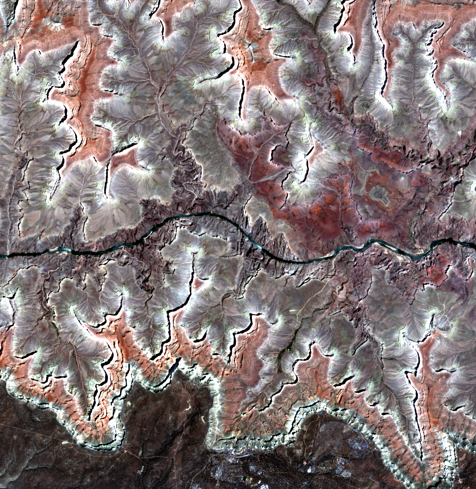
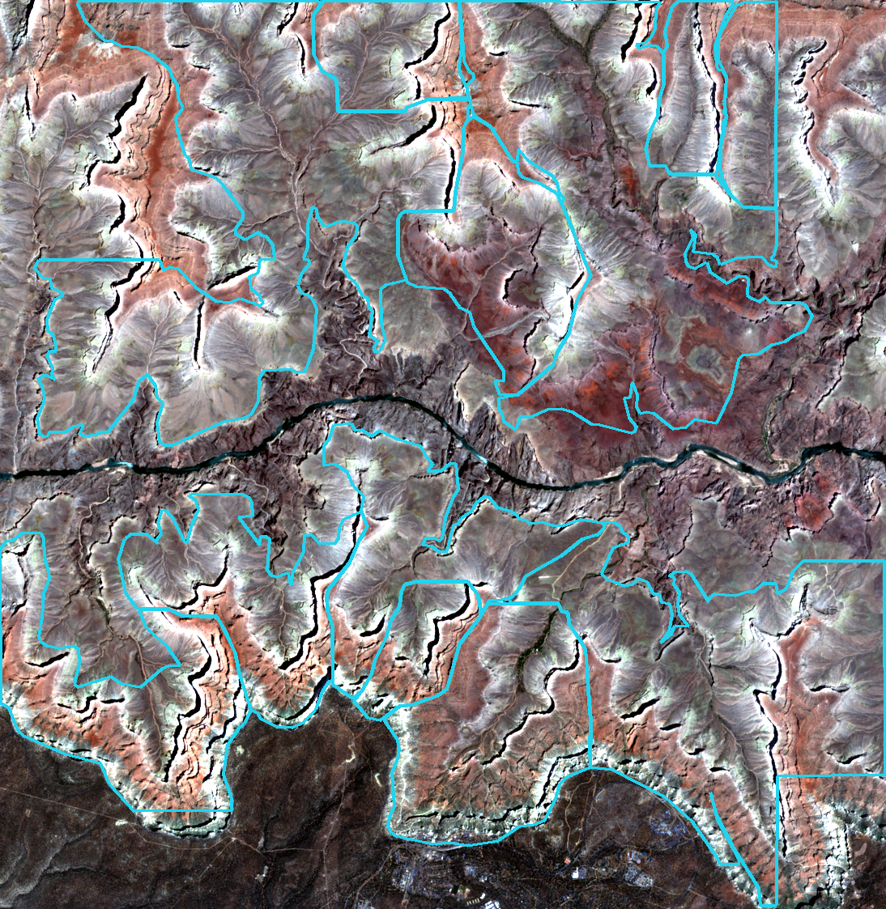

# CanyonScope — AI mapping of tributary canyons in the Grand Canyon, and a comparison with Mars

**CanyonScope** is a GeoAI app that finds and outlines *tributary canyons* (the side canyons that join the Colorado River) in Sentinel-2 satellite imagery with a YOLO segmentation model, separates neighbouring canyons with elevation data, and turns them into an interactive, downloadable map. The same Grand Canyon catalogue is then used as a **terrestrial analog** to test whether the side canyons of **Valles Marineris on Mars** have the shape of water-carved canyons.

**Live app:** https://canyonscope.streamlit.app

| | |
|---|---|
| Team | Shaimaa — sole developer and researcher (data preparation, annotation, model training, analysis, app) |
| Programme | National Space Academy (UAE Space Agency) — GeoAI capstone project, 2026 |
| App | Streamlit, deployed on Streamlit Community Cloud |
| Licence | GNU AGPL-3.0 (required by the Ultralytics YOLO licence) |

---

## 1. Problem, users and decision

**Problem.** Tributary canyons control how the Grand Canyon drains and erodes, and they are the source of the debris flows that build its rapids. There is no consistent, repeatable polygon map of them: mapping by hand is slow and subjective, and in satellite images shadows, similar rock colours and branching valleys hide where one canyon ends and the next begins.

**Intended users.** Geomorphologists, park and hazard planners, educators, and planetary scientists who use Earth landforms to interpret Mars.

**Decisions the app supports.**

- *Where are the tributary canyons in my area of interest, how big are they and what rock are they cut into?* — draw a box, run detection, download the polygons.
- *Can the Grand Canyon be used as a reference for Martian canyons?* — compare scale-free shape measurements of tributary canyons on both planets.

**Objective.** Develop and evaluate an AI workflow (Sentinel-2 + 3DEP DEM + YOLO instance segmentation) that detects and outlines individual tributary canyons, measure its accuracy and limits, and use its output as a reference for Valles Marineris.

### Variables

| Variable | Definition |
|---|---|
| Tributary canyon (operational) | A valley that joins the Colorado River canyon, with at least 250 m of relief and an area of at least 1 km², above the main canyon floor |
| Inputs | Sentinel-2 L2A reflectance (B04, B03, B02), USGS 3DEP 10 m elevation, relative terrain position (elevation minus its 1 km mean) |
| Outputs (per canyon) | Polygon, area (km²), estimated length and mean width (km), maximum and mean model confidence, centre coordinates, dominant geologic map unit |
| Evaluation | Pixel precision, pixel recall, pixel IoU (canyon terrain); shape recall (share of reference canyons covered at least 50 %) |

---

## 2. Data

| Data | Provider and identifier | Dates | Licence / terms |
|---|---|---|---|
| Sentinel-2 Level-2A (bands B02, B03, B04), 10 m | ESA Copernicus via Microsoft Planetary Computer, STAC collection `sentinel-2-l2a` | Training: 20 June 2026. App and catalogue: clearest scene in 15 May – 31 Aug 2026 (also 2025, 2024), cloud < 10 % | Copernicus Sentinel data, free and open. *Contains modified Copernicus Sentinel data 2026.* |
| Elevation, 10 m and 1 arc-second | USGS 3D Elevation Program via Microsoft Planetary Computer, collection `3dep-seamless` (`gsd` = 10 and 30) | Current seamless product | Public domain (USGS) |
| Geology | USGS State Geologic Map Compilation (SGMC), ScienceBase FeatureServer layer 3 | — | Public domain (USGS) |
| Canyon names (validation only) | USGS Geographic Names Information System, `DomesticNames_AZ_Text.zip` (feature class `Valley`) | Downloaded November 2026 | Public domain (USGS) |
| Mars elevation, 200 m | USGS Astrogeology, *Mars MGS MOLA – MEX HRSC Blended DEM Global 200m v2* (Fergason, Hare & Laura, 2018) | — | MOLA CC0; HRSC CC BY-SA 3.0 IGO |
| Basemap tiles (app only) | Esri World Imagery | — | Esri terms of use; attribution shown in the map |
| Photos and videos (app home page) | Wikimedia Commons, filtered to CC0, CC BY, CC BY-SA and public domain | — | Credited on each item |

**Study areas.** Pilot (training) area: −112.45, 35.95, −111.85, 36.35 (WGS 84), processed in UTM zone 12N (EPSG:32612). Full catalogue: −114.25, 35.45, −111.25, 37.05. Mars: Valles Marineris 92° W – 52° W, 0° – 18° S.

**Preprocessing.** Sentinel-2 processing baseline ≥ 04.00 adds an offset of 1,000, which is removed before converting to reflectance. RGB is stretched to 8 bit with fixed per-band limits saved in `data/processed/stretch_settings.json`, so training and inference use identical inputs.

---

## 3. Technical approach

### 3.1 Grand Canyon detector (Earth)

1. **Reference labels.** Candidate polygons were generated from the DEM (watershed on valley markers) and **reviewed and corrected by hand in QGIS** on RGB, valley–ridge and contour layers. Reference set: `annotations/canyons_ground_truth_v8.gpkg` (71 polygons, 457 km²), plus extra areas in Marble Canyon, the western Grand Canyon and Lava Falls (`annotations/expansion/`).
2. **Spatially separated splits** (no tile shares ground with another split): test = west of easting 382,000 m (Zone 1), validation = east of 412,000 m, training = the strips in between; Lava Falls is a second, independent test area.
3. **Dataset.** 640 × 640 px tiles (6.4 km), YOLO polygon labels, tiles with more than 25 % unlabelled canyon-like ground removed.
4. **Model.** Ultralytics YOLO `yolo26s-seg` (instance segmentation), `epochs=100`, `patience=30`, `imgsz=640`, `batch=8`, `seed=42`, trained on a Colab T4 GPU. Model v2 adds the extra areas (256 training tiles; best epoch 41).
5. **Inference.** 640 px tiles with a 320 px step, confidence threshold 0.05. Overlapping masks are rasterised as **votes** (at least 2 votes kept).
6. **Separating canyons with elevation.** Voted ground above a longitude-dependent river-floor elevation (700 m in the west to 1,250 m in Marble Canyon) is split into individual canyons by watershed segmentation seeded in valleys (elevation 50, 90 and 130 m below its 1 km mean). Shapes of 1–25 km² are kept.
7. **Catalogue.** The detector was run over the whole Grand Canyon in 157 resumable blocks (0.16° × 0.13°, 0.02° overlap) along the river, and each detection was linked to its dominant SGMC geologic unit.

### 3.2 Earth vs Mars (terrestrial analog)

All rules are written in units of **D**, the main-canyon depth (99.5th percentile of depth below the plateau): D = 1,229 m for the Grand Canyon and 9,237 m for Valles Marineris. Mars is analysed at 1,503 m pixels so that D spans the **same 6.1 pixels on both planets**.

- A tributary canyon is all canyon ground whose water enters the main-canyon floor through the same point (Priority-Flood depression filling, Barnes et al. 2014; D8 flow; main-canyon floor treated as base level because the Martian chasmata are closed basins).
- Rules were **calibrated on Earth only** against the YOLO catalogue (sensitivity tests, best F1), then **frozen** (`results/mars_analog/frozen_rules.json`) and applied unchanged to Mars.
- Seven dimensionless variables per tributary: area / D², length / D, width / D, elongation, solidity (branching), incision / D, relief / length. Compared with Mann–Whitney, Kolmogorov–Smirnov, Cliff's delta and a random-forest classifier (ROC AUC, 5-fold).

---

## 4. Results and validation

### 4.1 Detector (unseen test areas)

| Model | Test area | Pixel precision | Pixel recall | Pixel IoU | Shape recall |
|---|---|---|---|---|---|
| v1 | Zone 1 | 0.823 | 0.867 | 0.731 | 34 / 40 |
| v2 | Zone 1 | 0.907 | 0.726 | 0.676 | 0.75 |
| v1 | Lava Falls | — | — | 0.360 | — |
| v2 | Lava Falls | 0.790 | 0.599 | 0.516 | 0.679 |

**Independent check with official names (USGS GNIS).** GNIS lists 208 named valleys whose mouths lie inside the deep main canyon (at least 0.5 D = 614 m below the plateau), i.e. named tributaries of the Grand Canyon. These names were never used in training. A canyon counts as found when a detection lies within 500 m of its mouth-to-head line.

| Reach of the river | Named canyons (Canyon / Gorge) | Found | Recall |
|---|---|---|---|
| Central Grand Canyon (training region) | 123 | 102 | **82.9 %** |
| Western canyon / Lake Mead | 43 | 23 | 53.5 % |
| Marble Canyon (narrow, east) | 20 | 5 | 25.0 % |
| **All named canyons** | **186** | **130** | **69.9 %** |

All 208 named valleys including washes and draws: 140 found (67.3 %); 63.0 % within 250 m, 78.4 % within 2 km. 108 of the 325 catalogue canyons received their official name (`results/grand_canyon/grand_canyon_detections_named.geojson`), and the app names live detections the same way. The drop in Marble Canyon and the west matches the Lava Falls test: the model is strongest where it was trained. Code: `notebooks/gnis_validation.ipynb`.

Model v2 generalises much better to the western Grand Canyon (Lava Falls IoU 0.36 → 0.52) at a small cost in the pilot test zone. **Catalogue:** 325 tributary canyons, 2,397 km², mean confidence 0.33 (`results/grand_canyon/`). It is an experimental product, not a complete inventory.

### 4.2 Earth vs Mars

| Variable (tributaries ≥ 2 D²) | Earth | Mars | Mars / Earth | Cliff's delta | p |
|---|---|---|---|---|---|
| Area / D² | 5.09 | 5.44 | 1.07 | −0.04 | 0.56 |
| Length / D | 4.10 | 4.31 | 1.05 | −0.05 | 0.42 |
| Width / D | 1.28 | 1.29 | 1.01 | −0.02 | 0.82 |
| Elongation | 2.91 | 3.11 | 1.07 | −0.06 | 0.38 |
| Solidity | 0.77 | 0.74 | 0.97 | 0.08 | 0.21 |
| **Incision / D** | **0.53** | **0.32** | **0.61** | **0.60** | **< 0.001** |
| Relief / length | 0.17 | 0.14 | 0.82 | 0.20 | 0.003 |

**Finding:** the side canyons of Valles Marineris have the **same plan-view shape** as the water-carved tributaries of the Grand Canyon, but are **25–35 % less deeply incised** relative to their main canyon. Robustness: plan-view variables alone barely separate the planets (AUC 0.61) while incision does (0.76); the difference remains when incision is measured against the nearby main-canyon depth, and in the western, central and eastern parts of Valles Marineris. This is *consistent with* water shaping the side canyons while the main canyon deepened mainly by rifting — a hypothesis, not a proof.

### 4.3 Example (reproducible)

<!-- EXAMPLE_START -->
Command: `python scripts/example_detection.py` (area 122.86 km² near Grand Canyon Village,
bbox [-112.2, 36.05, -112.08, 36.15], Sentinel-2 scene of 2026-06-10: S2C_MSIL2A_20260610T180911_R084_T12SVF_20260610T231558, S2C_MSIL2A_20260610T180911_R084_T12SVE_20260610T231558, S2C_MSIL2A_20260610T180911_R084_T12SUF_20260610T231558, S2C_MSIL2A_20260610T180911_R084_T12SUE_20260610T231558).

| Input: Sentinel-2 true colour | Output: detected tributary canyons |
|---|---|
|  |  |

Result: **12 tributary canyons**, 67.3 km² of canyon ground, mean confidence
0.417, runtime 39 s in Google Colab. Polygons: `results/example/example_detections.geojson`;
all parameters: `results/example/metadata.json`.
<!-- EXAMPLE_END -->

---

## 5. Installation and running

**Python 3.13** (tested in Google Colab, November 2026). No API keys, accounts or environment variables are needed: all data come from public archives.

```bash
git clone https://github.com/gisshaimaa-ai/canyonscope.git
cd canyonscope
python -m venv .venv && source .venv/bin/activate      # Windows: .venv\Scripts\activate
pip install -r requirements.txt                          # 3-6 minutes (CPU-only PyTorch)
streamlit run app.py                                     # opens http://localhost:8501
```

**Reproduce the example output** (2–6 minutes, internet needed):

```bash
python scripts/example_detection.py
```

**Using the app**

1. **Home** — project overview, history and openly licensed media.
2. **Explorer** — draw a rectangle (up to 400 km²) inside the Grand Canyon region; detection starts automatically (about 1–4 minutes on Streamlit Cloud). See the Sentinel-2 input beside the detections, the geology of the area, a table of canyons, and download GeoJSON / CSV.
3. **Analytics** — statistics of the 325-canyon catalogue.
4. **Earth vs Mars** — maps of tributary canyons on both planets, the shape comparison and robustness checks.
5. **Method & Accuracy** and **Data** — metrics, sources and downloads.
6. **Learn** — canyon words explained (valley, canyon, gorge, tributary, mouth), a drawn 3D landscape and a short quiz.
7. **3D** — the Grand Canyon and Valles Marineris in 3D, in units of D or at true size.
8. **Ask** — questions answered only from the project’s own facts. Without a key it uses offline search (scikit-learn). Optional: add `GEMINI_API_KEY` (and `GEMINI_MODEL`) in the app’s Secrets on Streamlit Cloud to let Google Gemini write the answers from the same facts. Never commit a key to GitHub.

**Deploying on Streamlit Community Cloud:** connect this repository, choose branch `main`, main file `app.py`, Python 3.13. `packages.txt` installs the system libraries OpenCV needs.

**Reproducing the analysis** (optional; GPU recommended for training):

| Notebook | What it does | Runtime |
|---|---|---|
| `notebooks/earth_pipeline.ipynb` | Data download, labels, dataset, training (v1, v2), evaluation, full-canyon run, geology | Several hours on a Colab T4 |
| `notebooks/mars_analog.ipynb` | Earth and Mars elevation models, calibration, tributary extraction, statistics | About 30 minutes (High-RAM) |
| `notebooks/gnis_validation.ipynb` | Independent check against USGS GNIS names, error analysis by reach | 2 minutes |
| `scripts/make_terrain_3d.py` | Makes the small 3D depth maps for the 3D page | Seconds |
| `scripts/prepare_app_data.py` | Makes the light geology and Mars files the app reads | 1 minute |

Large intermediate files (imagery, DEMs, tiles, the 349 MB Mars raster) are rebuilt by the notebooks from the public sources above and are not stored in GitHub.

---

## 6. Repository structure

```
app.py                     Streamlit app (all pages)
learn.py, view3d.py, ask.py  Learn, 3D and Ask pages
detector.py                Live detection: Sentinel-2 + YOLO + DEM separation
analog/flowtools.py        Flow routing for the Earth vs Mars analysis
models/seg_rgb_v2/best.pt  Trained YOLO model (23 MB)
data/processed/            stretch_settings.json (reflectance limits used by training and inference)
data/sample_input/         Exact identifiers of the example inputs
annotations/               Reviewed reference polygons and annotation zones (EPSG:32612)
results/                   Small final outputs used by the app and shown in this README
results/gnis_validation/   Independent check against official USGS GNIS canyon names
notebooks/                 Full Earth pipeline and Earth vs Mars analysis
scripts/                   Example run and app-data preparation
assets/                    Hero image and media list for the home page
```

---

## 7. Limitations

- Test samples are small, and pixel metrics measure canyon *terrain* better than the separation of individual canyons (only 2 of 10 manually drawn canyons matched at IoU 0.5).
- The model was trained on Grand Canyon rocks and colours; it is not expected to work in other landscapes without new training samples. Inside the Grand Canyon it is weakest in narrow Marble Canyon (25 % of named canyons found).
- The catalogue is experimental and incomplete; confidence scores are not calibrated probabilities.
- SGMC geology is regional (about 1 : 1,000,000); most detections fall in broad sedimentary units.
- Earth vs Mars uses 200 m elevation data, one Earth reference canyon and an incomplete calibration catalogue; the Mars grid has up to about 4 % east–west scale error at its edges; gravity differences were not modelled.

## 8. Next steps

Higher-resolution Mars terrain models (CTX, HiRISE) to measure canyon-head shape; more Earth analogs, including rifted canyons; training samples from other arid regions; uploading the catalogue to a gIQ story.

## 9. Licence and attribution

Code: **GNU AGPL-3.0** (see `LICENSE`), because the app uses Ultralytics YOLO (AGPL-3.0). Data remain under their own licences listed in section 2. Contains modified Copernicus Sentinel data 2026. Elevation and geology courtesy of the U.S. Geological Survey. Mars elevation: Fergason, R. L., Hare, T. M., & Laura, J. (2018), HRSC and MOLA Blended Digital Elevation Model at 200m v2, USGS Astrogeology. Barnes, R., Lehman, C., & Mulla, D. (2014), Priority-flood, *Computers & Geosciences* 62, 117–127. AI coding assistant (Claude) was used for code drafting; all results were run and checked in Google Colab.
